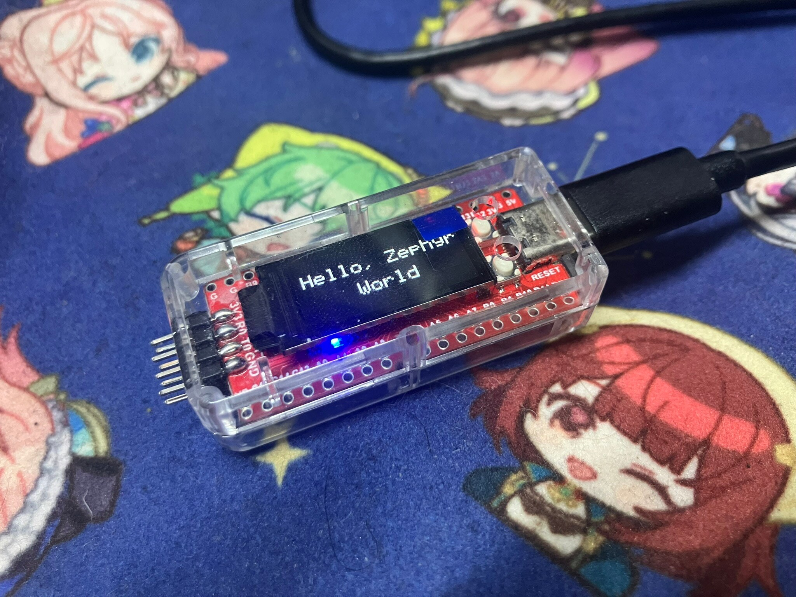
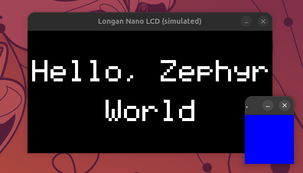

# Longan Nano Zephyr application

A Zephyr Hello World application for the Longan Nano. It displays
"Hello, Zephyr World" on two lines on the LCD and cycles the RGB LED through
red, green, and blue at one-second intervals.



The display rendering and LED control are implemented in Rust (`no_std`).
The interfaces to Zephyr drivers and Devicetree are implemented in C.

The project root is a west workspace. Zephyr is pinned to a Zephyr 4.5.0
commit as a Git submodule. The GD32 HAL revision is specified by that version
of Zephyr's west manifest.

```text
longannano/
├── .west/              # Generated locally
├── CMakeLists.txt
├── Cargo.toml
├── Cargo.lock
├── modules/            # Fetched by west
├── prj.conf
├── src/
│   ├── lib.rs          # Display rendering and LED control
│   └── main.c          # Interface to Zephyr drivers
└── zephyr/             # Git submodule
```

## Setup

Install the [Zephyr host dependencies](https://docs.zephyrproject.org/4.5.0/develop/getting_started/index.html)
and run the commands below from this directory. Also install Rust and Cargo
using [rustup](https://rustup.rs/) and add the Rust target for Longan Nano.

```sh
git clone https://github.com/h1romas4/longannano-zephyr
cd longannano-zephyr
git submodule update --init
rustup target add riscv32i-unknown-none-elf
python3 -m venv .venv
. .venv/bin/activate
pip install west -r zephyr/scripts/requirements-base.txt
export ZEPHYR_BASE="$PWD/zephyr"
west init -l zephyr
west update --narrow --fetch-opt=--depth=1 hal_gigadevice
export ZEPHYR_SDK_INSTALL_DIR="$PWD/.sdk"
west sdk install --install-dir "$ZEPHYR_SDK_INSTALL_DIR" -t riscv64-zephyr-elf
```

`west init` is needed only once. After updating the Zephyr submodule commit,
run `west update --narrow --fetch-opt=--depth=1 hal_gigadevice` again to obtain
the matching HAL. If additional Zephyr modules are needed, run `west update`
for those modules in the same workspace.

This project does not use Zephyr 4.5.0's official Rust module because it
generates references to disabled GPIO nodes on Longan Nano, causing the
build to fail. Instead, CMake uses Cargo to build a Rust static library
without external dependencies and links it with Zephyr. Rust accesses
devices through the C bridge.

## Building and flashing

Activate the virtual environment and build with west from the project root.

```sh
. .venv/bin/activate
export ZEPHYR_BASE="$PWD/zephyr"
export ZEPHYR_SDK_INSTALL_DIR="$PWD/.sdk"
west build -b longan_nano -d build/west/longan .
```

Flash from the project root:

```sh
west flash -d build/west/longan
```

By default, `west flash` uses OpenOCD with an external programmer. To use USB
DFU, put the board in DFU mode and run
`west flash -d build/west/longan --runner dfu-util` instead.

For the Lite version, specify a separate build directory from the project root:

```sh
west build -b longan_nano/gd32vf103/lite -d build/west/lite .
```

To flash the Lite version, run `west flash -d build/west/lite`.

The console uses USART0 (TX: PA9, RX: PA10, 115200 baud). To see the output,
connect the RX of a 3.3 V USB-to-serial adapter to the board's TX and connect
their grounds. USB DFU is separate from console output.

## Running with native_sim



A Linux host with a C compiler, SDL2 development libraries, pkg-config, and a
graphical desktop is required. The simulator targets 64-bit x86_64 or aarch64
Linux and uses the host Rust target. Run the following from the project root:

```sh
. .venv/bin/activate
export ZEPHYR_BASE="$PWD/zephyr"
export ZEPHYR_SDK_INSTALL_DIR="$PWD/.sdk"
west build -b native_sim/native/64 -d build/west/native . -- \
  -DZEPHYR_TOOLCHAIN_VARIANT=host
west build -d build/west/native -t run
```

The LCD and RGB LED states appear in separate windows. The LCD is displayed
at an enlarged scale using the same 160×80-pixel resolution as the board.
The LED window visualizes the GPIO output state; it does not simulate the
electrical behavior of the physical LED or LCD controller. The simulator is
configured to run in real time, so the LED changes once per second. Press
Ctrl+C in the terminal to exit.

Run the Rust rendering test with `cargo test --locked`.

For more information, see the [Zephyr Longan Nano board documentation](https://docs.zephyrproject.org/4.5.0/boards/sipeed/longan_nano/doc/index.html).

## VS Code

- **Terminal:** New integrated terminals on Linux set `ZEPHYR_BASE` and
  `ZEPHYR_SDK_INSTALL_DIR` to the project-local paths and add `.venv/bin` to
  `PATH`. Shell startup files can override these settings; if they do, set
  the variables after the shell starts, as shown in [Setup](#setup).
- **Tasks:** Use **Tasks: Run Build Task** to build native-sim, Longan Nano or
  Lite. **Tasks: Run Task** also offers flash tasks for both boards with
  OpenOCD or USB DFU. Tasks require `west` on `PATH` and the Zephyr environment
  to be configured in their terminal.
- **rust-analyzer:** Checks the host target with aborting panics, matching the
  Rust static library's release build. Check the board target separately with
  `cargo check --locked --release --target riscv32i-unknown-none-elf`.

## Continuous integration

GitHub Actions checks Rust formatting and tests, builds both Longan Nano
variants and the native simulator, and checks that the simulator starts
successfully using SDL's headless software renderer.
